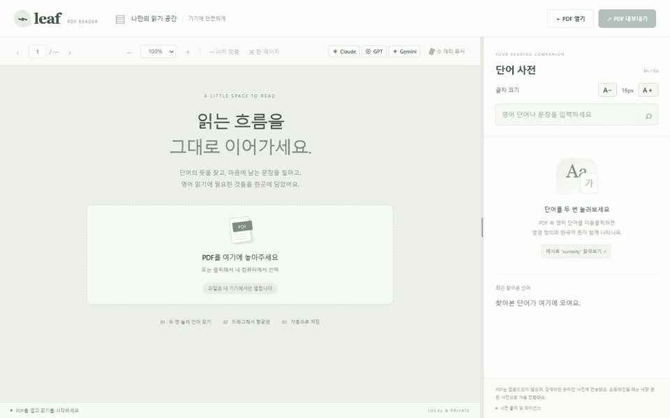

# Leaf PDF 리더 (Leaf PDF Reader)

영어 원서·논문 읽기에 필요한 **영영·영한 사전, 문장 번역, 형광펜·메모, 나의 단어장·문장 모음, AI 바로가기(Claude·GPT·Gemini)**를 한 화면에 담은 PDF 리더입니다. PDF 원본은 브라우저에서 열며 업로드하지 않습니다. 로그인하면 사용자가 저장한 단어·문장과 그 뜻·출처·복습 상태만 Firebase에 동기화합니다.

- 🚀 **설치 없이 웹에서 바로 써보기:** **[https://linkdiscovery.github.io/leaf-pdf-reader/](https://linkdiscovery.github.io/leaf-pdf-reader/)**
- 💬 **피드백 · 기능 제안 남기기:** **[GitHub Issues에 의견 남기기 ↗](https://github.com/LinkDiscovery/leaf-pdf-reader/issues/new?template=feedback.md)**

- **고화질 원본 영상 다운로드:** [demo/leaf-pdf-reader-demo.webm](demo/leaf-pdf-reader-demo.webm)

## 실행 방법 (웹 또는 내 컴퓨터)

### 방법 1. 웹에서 바로 실행 (설치 불필요 · 추천)
1. **[https://linkdiscovery.github.io/leaf-pdf-reader/](https://linkdiscovery.github.io/leaf-pdf-reader/)** 에 접속합니다.
2. **PDF 열기**를 누르거나 내 컴퓨터의 PDF 파일을 화면으로 끌어놓으면 바로 사용할 수 있습니다.

### 방법 2. 내 컴퓨터에 다운로드해서 로컬 실행 (Windows)
1. 이 저장소를 `git clone https://github.com/LinkDiscovery/leaf-pdf-reader.git` 하거나 우측 상단 **Code → Download ZIP**으로 내려받습니다 ([Node.js 22+](https://nodejs.org/) 필요).
2. 폴더 안의 **`PDF-Reader.cmd`**를 더블클릭하면 자동으로 빌드 후 브라우저(`http://127.0.0.1:4173`)가 열립니다.
3. 실행한 명령 창은 읽는 동안 열어 두세요. 종료할 때 창을 닫거나 `Ctrl+C`를 누르면 됩니다.

## 사용법

처음 방문하면 버튼을 밝게 강조하고 주변을 어둡게 하는 **단계별 사용 안내**가 시작됩니다. **이전 / 다음 / 건너뛰기**로 진행하며, 끝내거나 닫으면 같은 브라우저에서 다시 자동 표시하지 않습니다. 필요할 때 상단 **사용법**으로 다시 여세요. PDF가 없는 상태에서도 선택 메뉴 예시로 형광펜·단어장 추가를 설명하며, 안내 중에는 실제 기록을 바꾸지 않습니다.

첫 화면의 **읽기 → 저장 → 복습** 요약과 **전체 사용법**도 이용할 수 있습니다. 전체 사용법에는 저장 위치와 동기화 범위·단축키를 정리했습니다. 다른 브라우저나 기기, 사이트 데이터 삭제 후에는 처음 사용 안내가 다시 표시될 수 있습니다.

상단 **화면 글자**에서 **기본 / 크게 / 아주 크게**를 선택하면 메뉴·설명·학습 카드의 글자가 커지고 현재 브라우저에 기억됩니다. 기본 본문은 16px, 보조 설명은 주로 14px입니다. PDF 원문은 PDF 배율로, 사전 결과는 **A− / A＋**로 따로 조절하세요. 사전의 최초 기본 글자는 18px이며 기존에 선택한 크기는 유지합니다.

### 나의 단어장 · 나의 문장 (v1.2)

상단 **PDF 읽기 / 나의 단어장 / 나의 문장** 탭을 오가며 읽기와 복습을 이어갑니다. 탭을 바꿔도 열어 둔 PDF와 배율, 읽던 위치를 유지합니다.

1. **단어 저장:** PDF에서 단어를 드래그하고 형광펜 메뉴의 **단어장 추가**를 누릅니다. 선택한 원문·출처·페이지와 가능한 경우 예시문장을 채웁니다. 같은 표현의 사전 결과가 이미 있으면 뜻도 가져오고, 없으면 저장 창에서 직접 입력할 수 있습니다. 사전에 검색한 뒤 **단어장에 저장**을 눌러도 됩니다. 자동 추출은 문서 배치에 따라 어색할 수 있으니 저장 전에 확인하세요.
2. **문장 저장:** PDF 문장을 드래그하고 **문장 저장**을 누릅니다. 번역도 함께 채우려면 **뜻 · 번역**으로 번역한 뒤 사전의 **문장 모음에 저장**을 사용하세요. 번역을 가져오지 못하면 직접 입력할 수 있습니다.
3. **직접 추가·편집:** 각 학습 탭의 **직접 추가**, 카드의 **수정 / 삭제**로 관리합니다. 출처와 페이지도 수정할 수 있습니다. 같은 단어를 다른 뜻·예문으로 저장할 수 있으며 중복 표현은 저장 창에서 안내합니다.
4. **복습:** **뜻·번역 가리고 복습**을 체크하고 카드의 **뜻·번역 확인**을 눌러 답을 봅니다. **외웠어요 / 다시 학습**으로 상태를 바꾸고, 전체·학습 중·외웠어요 필터나 검색으로 골라 봅니다.
5. **다른 컴퓨터에서 이어 보기:** **Google 로그인**을 누르고 같은 계정을 사용합니다. `동기화 완료`가 표시되면 다른 컴퓨터에서도 같은 단어·문장과 복습 상태를 볼 수 있습니다. PDF는 각 컴퓨터의 폴더에서 직접 열어 주세요.
6. **로그인 전에 저장한 내용:** 현재 브라우저에 별도로 남습니다. 로그인 후 **기기 기록 가져오기**로 내 계정에 복사할 수 있습니다. 자동 업로드하지 않으며, 같은 ID의 기록은 중복 추가하지 않습니다.
7. **백업:** **백업 내보내기**로 현재 단어·문장 전체를 JSON 파일로 보관합니다. **백업 가져오기**는 기존 ID를 덮어쓰지 않고 없는 기록만 추가합니다. 잘못 삭제했거나 다른 계정으로 옮길 때 활용하세요.

동기화는 프로젝트 소유자가 Google 로그인, Firestore 데이터베이스와 접근 규칙을 설정해야 동작합니다. **[Firebase 최초 설정과 문제 해결](docs/firebase-setup.md)**을 참고하세요. Firebase 미설정 상태에서도 기기 저장은 사용할 수 있습니다.

마우스는 **각자 설정한 기본 포인터와 속도를 그대로 사용**합니다. 왼쪽 클릭 위치에만 작은 원이 잠깐 나타났다 사라집니다. 상단 **클릭 효과** 체크를 해제하면 원도 표시하지 않습니다. 이 설정은 현재 브라우저에 저장됩니다. 이동 중 따라오는 포인터 효과는 없습니다.

### PDF 읽기

- **단어 발음:** 사전 결과의 단어 옆 또는 **나의 단어장** 카드의 **🔊 듣기**를 누릅니다. 재생 중 다시 누르면 멈추고, 다른 단어를 누르면 이전 발음을 중단합니다. 탭을 바꾸거나 화면을 떠나도 재생을 멈춥니다. 현재는 단어·짧은 표현(100자 이내)에만 제공하며 문장 모음에는 넣지 않았습니다.
- **음성 지원:** 기기에 설치된 영어 음성을 우선 사용하고, 사용할 수 없으면 무료 사전 발음(Free Dictionary API·Google Dictionary)으로 재생합니다. 재생되지 않는 주소는 다음 발음 파일로 넘어갑니다. 별도 API 키·유료 음성 서비스가 필요 없습니다. 사전 발음에는 인터넷이 필요하며, 등록되지 않은 단어·구문은 발음이 없을 수 있습니다. 원격 음성과 사전 발음 이용 시 조회한 단어가 해당 제공자에게 전송됩니다. 음성 파일은 Firebase에 저장하지 않습니다.

- **단어 조회 및 문장 번역:** PDF의 영어 단어를 더블클릭하거나 오른쪽 검색창에 입력합니다. 문장을 드래그한 뒤 **뜻 · 번역 ↗**을 누르면 전체 문장 한국어 번역과 개별 단어 바로가기 칩이 표시됩니다.
- **AI 바로가기:** 상단 툴바 오른쪽(형광펜 개수 왼쪽)의 **Claude · GPT · Gemini** 버튼을 누르면 새 탭으로 열립니다. PDF에서 문장을 드래그한 채로 누르면 해당 문장이 클립보드에 자동 복사됩니다.
- **형광펜:** 문장을 드래그한 뒤 노랑·초록·분홍 버튼을 누릅니다.
- **형광펜에서 학습 기록 추가:** 새로 칠한 형광펜을 다시 클릭해 **단어장 추가 / 문장 저장**을 누를 수 있습니다. 형광펜과 함께 선택 원문을 기기에 저장합니다. 원문이 저장되지 않은 예전 형광펜은 원문을 다시 드래그해 주세요. 학습 기록 저장 자체가 형광펜을 추가하거나 지우지는 않습니다.
- **수정/삭제:** 칠해진 영역을 클릭해 색을 바꾸거나 삭제합니다.
- **페이지:** 상단 화살표나 페이지 번호 입력으로 이동합니다. 연속 스크롤도 됩니다.
- **사전 글자:** 오른쪽 상단 A− / A＋로 기본 글자 크기를 14~22px로 조절합니다. 한국어 뜻은 더 크게 표시하고, 보조 영문 설명은 펼쳐 볼 수 있습니다.
- **패널 너비:** PDF와 사전 사이 경계를 드래그합니다. 경계를 키보드로 선택한 뒤 좌우 화살표로도 조절할 수 있고, 더블클릭하면 기본 폭으로 돌아옵니다. 글자 크기와 폭은 저장됩니다.
- **확대/축소:** PDF 위에서 Ctrl+마우스 휠로 마우스 위치를 기준으로 확대·축소합니다. 상단에서 배율을 선택하거나 너비 맞춤 / 한 페이지를 누를 수 있습니다. PDF 영역에서는 Ctrl+＋, Ctrl+−, Ctrl+0 단축키도 됩니다.
- **문장 메모:** 문장을 드래그한 뒤 메모 쓰기를 누릅니다. 기존 형광펜을 클릭해서 메모를 추가할 수도 있습니다. 저장된 메모는 문장 옆 작은 메모 아이콘으로 다시 열어 수정합니다.
- **메모 삭제:** 메모 창의 메모만 삭제는 형광펜을 남깁니다. 형광펜의 표시·메모 삭제는 둘 다 삭제합니다.
- **내보내기:** 오른쪽 위 PDF 내보내기를 누르면 원래이름-형광펜.pdf가 다운로드됩니다. 원본은 바뀌지 않습니다. 메모가 있으면 표준 PDF 주석으로 함께 저장되므로 다른 뷰어의 메모/주석 기능에서 읽을 수 있습니다.

예제 PDF는 public\sample.pdf에 있습니다. 일반, 회전, CropBox, 텍스트 없는 페이지를 포함합니다.

## 저장과 오프라인 사용

- PDF 원본과 PDF에 붙인 형광펜·메모는 업로드하지 않습니다. 문장 메모를 만들면 연결된 문장 일부와 메모를 기기의 브라우저 저장소에 함께 저장합니다. **단어장·문장 모음에 저장한 내용은 로그인 상태에서 Firebase에 전송**되며, 다른 사용자의 기록과는 계정별로 분리됩니다.
- 영한 사전은 온라인일 때 무료 사전·번역 API로 먼저 조회하며, 오프라인이거나 미지원 단어일 때는 앱에 내장된 오프라인 영한 사전(`en-ko.json`)으로 자동 전환됩니다. 인터넷 없이도 PDF 읽기, 내장 영한 조회, 형광펜·메모 저장, 내보내기를 사용할 수 있습니다.
- 영영 사전은 Free Dictionary API에 검색어를 전송합니다. 연결 실패 시 영영 영역에 안내가 나오며 영한 검색은 계속 동작합니다.
- 형광펜은 PDF 내용의 SHA-256으로 구분해 **현재 브라우저 프로필의 IndexedDB**에 저장합니다. 파일명만 바꾼 같은 PDF도 표시가 복원됩니다.
- 형광펜 저장 위치는 브라우저 프로필 설정을 따릅니다. 브라우저/프로필/앱 주소를 바꾸거나 사이트 데이터를 삭제하면 별도 저장소가 됩니다. 시크릿 모드의 데이터는 창을 닫으면 사라질 수 있습니다. 로그인 전 단어장도 해당 브라우저에만 저장됩니다.
- 로그인한 단어장·문장은 기기에 사본과 전송 대기열을 저장합니다. 연결이 돌아오면 동기화하며, 대기 중에는 로그아웃을 막습니다. 같은 필드의 동시 수정은 서버에 마지막으로 반영된 쓰기가 남습니다. 공용 컴퓨터에서는 사용 후 사이트 데이터까지 지우세요. 로그아웃은 화면의 계정 기록을 숨기지만 오프라인 캐시를 완전히 삭제하지는 않습니다.
- 형광펜과 앱에서 작성한 메모는 원본 PDF를 다시 열어 편집합니다. 외부 PDF 주석을 이 앱의 메모로 가져오는 기능은 아직 없습니다. 내보낸 복사본의 색은 PDF 페이지에 그려진 것으로, 앱의 편집 가능한 표시 목록과는 별개입니다.

## 지원 범위

- 비밀번호가 있는 PDF는 올바른 비밀번호로 열 수 있습니다.
- 암호화된 PDF의 **내보내기**와 스캔 이미지의 **OCR**은 후속 범위입니다.
- 영한 사전은 모든 단어를 포함하지 않습니다. 표제어 및 원본 활용형 인덱스에서 조회하며, 없는 단어는 안내합니다.
- 브라우저가 화면 주변의 페이지만 그려 메모리를 줄입니다. 매우 큰 파일의 원본 바이트와 페이지 정보는 여전히 메모리를 사용합니다.
- 표시는 브라우저 저장소에 기록되며, 저장 실패 시 경고를 보여 줍니다. 중요한 표시는 PDF 복사본으로 내보내 보관하세요.

## 개발

Node.js 22.13 이상 또는 24 이상과 npm을 사용합니다.

    cd leaf-pdf-reader
    npm.cmd ci
    npm.cmd run dev

프로덕션 빌드와 실행:

    npm.cmd run build
    npm.cmd start

사전 재변환(동봉된 원본 ZIP 사용):

    node scripts/convert-dictionary.mjs public/dictionary/en-ko-source.zip
    npm.cmd run build

## 검증

    npm.cmd run build
    npm.cmd test

학습 데이터 보안 규칙 및 두 브라우저 동기화 검사(Java 21+ 필요, 운영 데이터 미사용):

    npm.cmd run test:rules
    npm.cmd run test:sync

Playwright는 설치된 Microsoft Edge를 사용합니다. 검사 항목:

- 실제 마우스 더블클릭과 여러 줄 드래그, 영영·영한 동시 표시
- 활용형 조회, 빠른 연속 검색의 마지막 결과, 영영 연결 실패
- 형광펜 생성/색 변경/삭제, 확대와 창 크기 변경
- 재열기·파일명 변경 시 복원, 이름이 같고 내용이 다른 파일 분리
- 여러 페이지 선택 및 회전·CropBox·회전+CropBox 좌표
- 내보낸 PDF의 텍스트 유지와 실제 렌더 픽셀의 색 위치
- 스캔 페이지 안내, 드래그 앤 드롭, 잘못된 PDF, 좁은 화면
- 비밀번호 요구/오입력/취소/열기, 암호화 PDF 내보내기 안내
- 파일을 빠르게 바꾸거나 렌더를 취소할 때 마지막 문서 유지
- 사전 글자 크기 및 경계 드래그/키보드 조절과 설정 복원
- 문장 메모 작성/취소/수정/복원/삭제, 한글·이모지 PDF 주석
- 배율 선택, 한 페이지 맞춤, 마우스 위치 기준 Ctrl+휠 확대 및 단축키

자동화는 기존 PDF 9개 시나리오, 학습 기록 3개 시나리오와 별도 Firebase 에뮬레이터 동기화 시나리오를 포함합니다. 보안 규칙 검사는 본인 기록 CRUD, 타 계정·비로그인 접근 차단, 데이터 형식·길이 제한을 확인합니다. 실제 Google 로그인 팝업과 운영 프로젝트 설정은 최초 연결 후 별도 확인이 필요합니다. 영영·영한 자동화 응답은 재현성을 위해 모의 응답을 사용합니다. 수동 연결 확인은 node scripts/check-live.mjs, Edge 기본 PDF 뷰어 확인은 node scripts/check-native-export.mjs로 할 수 있습니다. 두 보조 스크립트는 앱을 실행한 상태에서 사용합니다.

## 사전과 라이브러리 출처

- [PDF.js](https://mozilla.github.io/pdf.js/) — Apache-2.0
- [pdf-lib](https://pdf-lib.js.org/) — MIT
- [Firebase JavaScript SDK](https://github.com/firebase/firebase-js-sdk) — Apache-2.0; 계정별 단어·문장 동기화
- [Free Dictionary API](https://dictionaryapi.dev/) — 영영 사전; 각 응답의 정의 출처 링크를 화면에 표시
- [KOReader Dicts English → Korean](https://danielgregorini.github.io/koreader-dicts/en/en-ko/) — 영한 사전
- [CC BY-SA 4.0](https://creativecommons.org/licenses/by-sa/4.0/) — 영한 변환 데이터 라이선스

영한 원본 날짜: **2026.09.11**. 표제어 25,985개, .syn 연결 79,218개. 원본 설명의 활용형 수 76,501개와 연결 수는 집계 기준이 다릅니다. 원본 데이터: Princeton WordNet 3.0, English Wiktionary / kaikki.org (wiktextract).

변경 사항: StarDict의 HTML 정의, 표제어 및 .syn 연결을 검색용 JSON으로 변환했습니다. 정의 내용은 변경하지 않았고, 화면에는 허용된 텍스트 서식만 표시합니다. 변환 데이터도 CC BY-SA 4.0으로 제공합니다. 원본 ATTRIBUTION, LICENSE, 원본 ZIP과 버전·SHA-256 정보는 public\dictionary에 보존되어 있으며 화면 하단에서도 열 수 있습니다.

비밀번호 시험 PDF: Mozilla PDF.js의 test/pdfs/pr6531_1.pdf, [검사 코드 및 비밀번호 출처](https://github.com/mozilla/pdf.js/blob/master/test/unit/api_spec.js). 기능 검사에만 사용합니다.
